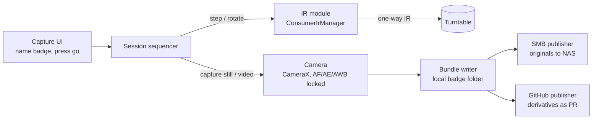

# Badge Museum Turntable Capture App — Plan

> Imported from the [Claude Docs plan](https://claude.ai/artifact/QJYGK5XuYAGidwT8Vukawb) (Nov 3, 2026). This is background research; the working spec is [Spec.md](Spec.md).

## Goal and scope

Build an Android app that drives the IR turntable from the phone's built-in IR blaster, shoots a fixed set of stills plus a 360 video of each badge, and hands off a ready-to-publish "badge bundle" to the badge museum. Metadata (con, year, maker, notes) gets filled in later; the app only needs enough to name and file the capture.

### MVP (v1)

- One-tap capture session: name the badge, press go, walk away.
- N stills at evenly spaced angles (e.g. 8 or 12), with exposure, focus and white balance locked so every frame matches.
- One continuous 360 video on a full rotation.
- Output: a folder per badge with images, video, thumbnails and a `badge.json` manifest.
- One publishing path that works end to end (see [Publishing paths](#publishing-paths)).

### Later

- Front/back flip prompt (shoot side A, flip, shoot side B).
- Dense spin sets (24–36 frames) for an interactive drag-to-rotate viewer on the site.
- Lit/unlit passes for LED badges (shoot once powered, once dark).
- Background removal or auto-crop, batch re-upload, a queue for offline captures.
- Possibly photogrammetry-grade sets if a 3D viewer ever makes sense.

## Existing apps and resources

Nothing off the shelf does IR turntable + phone camera + git/SMB publishing, so this is a build. The commercial turntable apps that do exist are tied to their own Bluetooth hardware; the useful pieces are open-source IR tooling and web spin viewers.

| Resource | What it is | How it helps |
| --- | --- | --- |
| [Android ConsumerIrManager](https://developer.android.com/reference/android/hardware/ConsumerIrManager) | Built-in Android IR API: `transmit(carrierHz, int[] pattern)` in microseconds, synchronous, max 2 s per pattern | The whole IR side of the app. No library needed. |
| [iodn/android-ir-blaster](https://github.com/iodn/android-ir-blaster) | Open-source Android IR remote with protocol encoders, raw mode, brute-force "IR Finder", imports Flipper `.ir`, irplus and LIRC files | Reference code for NEC/raw encoding, and a quick way to test codes from the phone before writing anything |
| [irplus](https://www.apkmirror.com/apk/binarymode/irplus-infrared-remote) | Closed-source Android IR remote with XML layouts and an on/off graph of sent codes | Another no-code way to prove the blaster can drive the table |
| [Flipper-IRDB](https://github.com/Lucaslhm/Flipper-IRDB) | Large CC0 database of plain-text `.ir` remote files | Check for the turntable's remote; contribute it back once captured |
| [Foldio360 app](https://apps.apple.com/us/app/foldio360/id1144327537) | Commercial turntable + phone app (Bluetooth only) | UX reference only: frames-per-rotation setting, auto shoot, GIF/video export |
| Visere Captura / Pictomic | Android remote-camera app paired with their turntables, turn–stop–snap and video modes | Confirms the turn-stop-snap workflow; tied to their hardware |
| [js-cloudimage-360-view](https://github.com/scaleflex/js-cloudimage-360-view), [egjs SpinViewer](https://naver.github.io/egjs-view360/v3/spinviewer.html), [Threesixty](https://www.cssscript.com/draggable-360-image-preview-threesixty/) | Static JS 360 viewers from an image sequence or sprite sheet | Drop-in for a GitHub Pages site; CI360 also does X and Y axis spins |
| [CameraX FocusMeteringAction](https://developer.android.com/reference/androidx/camera/core/FocusMeteringAction) | `setLockingMode` (CameraX 1.7+) locks AF, AE and AWB after metering | Consistent frames across a spin |
| [jcifs-ng](https://www.b4x.com/android/forum/threads/jcifs-ng-smb-client-smb2.104560/), smbj | Pure-Java SMB2/3 clients | SMB upload path; smbj needs Android 8+ |

Turntable remotes in this class (ComXim, JAYEGT and similar) typically offer continuous rotation, single-step and repeated-step modes at 45°, 90° and 180°, plus speed and direction. Some higher-end units list 11 presets down to 5° ([B&H spec sheet](https://www.bhphotovideo.com/lit_files/1349744.pdf)). Which of these your remote has decides the capture strategy.

## Architecture

A single sequencer owns the session: it alternates IR commands and camera captures, then hands a finished folder to the bundle writer and publishers.



- **IR module.** `ConsumerIrManager.transmit()` blocks until sent and caps a pattern at 2 s, so each button press is one call. Codes live in a turntable profile (a Flipper `.ir` file), so swapping turntables is a config change.
- **Timing.** IR is one-way: no confirmation the table moved. The sequencer waits a measured settle time per step (from the Phase 0 timing) before shooting. If the remote has no step buttons, fall back to continuous rotation and shoot on a timer, which is less precise.
- **Camera.** Meter once on the first frame, then lock AF, AE and AWB so every angle matches; fixed zoom, no flash. Video uses the same locks and runs for one measured revolution plus a short margin.
- **Output.** Every session writes a self-contained badge folder locally first, so a failed upload never loses a capture.

## Publishing paths

Recommendation: send full-resolution originals to the SMB share as the archive, and push only web-sized derivatives to the GitHub Pages repo as a pull request. Direct upload to a Pages site is impossible (it is static hosting), but committing through the GitHub API from the phone is easy.

| Path | How | Pros | Cons |
| --- | --- | --- | --- |
| GitHub API commit or PR | Fine-grained token with `contents:write`; create blobs, a tree, a commit, then a branch + PR ([Git blobs API](https://docs.github.com/en/v3/git/blobs)) | Works from anywhere; one atomic commit per badge; PR lets you add metadata before merge | Repo and site size limits; token lives on the phone |
| Local git clone on the phone | JGit or similar, then push | Real git history and offline commits | Clones a growing media repo onto the phone; heavier to build |
| SMB share | jcifs-ng or smbj, write the bundle folder to the NAS | Unlimited originals; LAN-fast; no token in the cloud | Only works at home or over VPN; a separate step publishes to the site |
| **Hybrid (recommended)** | Originals to SMB, derivatives to GitHub PR | Archive and site both handled in one session | Two code paths |

### Size limits that matter

From the [GitHub Pages limits](https://help.github.com/articles/what-is-github-pages): source repos are recommended under 1 GB, published sites may be no larger than 1 GB, bandwidth is a soft 100 GB per month, and Git rejects any file over 100 MB. Git LFS does not work with the Pages build.

Rough budget (estimate, to verify with real captures): 12 stills at 1600 px WebP is about 3 MB, and a 20–30 s 720p H.264 spin video is about 5 MB. At ~8 MB per badge, 1 GB holds roughly 125 badges. If the museum will grow past that, plan now to host media outside the Pages repo (object storage behind a CDN, or one media repo per con or year) and keep only JSON and thumbnails in the site repo.

## Open questions

The turntable remote is the biggest unknown: whether it has step-angle buttons decides whether stills are precise or time-based.

### Hardware

- [ ] Which turntable make and model, and what buttons does its remote have (step 45/90/180°, repeated step, speed, direction, start/stop)?
- [ ] What protocol and carrier do the codes use (NEC at 38 kHz is most likely)? Capture with a Flipper, an IR receiver on an Arduino/Pico, or android-ir-blaster's brute-force finder.
- [ ] Does the table hold its angle between steps (stepper) or drift (DC motor)? How repeatable is 8 × 45° = 360°?
- [ ] Seconds per revolution at each speed, for timing video and step waits.
- [ ] Does the phone reach the table's IR sensor from the camera position, or does it need a reflector, or a cheap USB/audio IR LED pointed at the sensor?
- [ ] Which phone model and Android version? Does `getCarrierFrequencies()` include 38 kHz and does raw transmit work?
- [ ] Phone mount: fixed tripod height and angle, or several elevations per badge?

### Capture

- [ ] How many stills per badge: 4, 8, 12, or a 24–36 frame spin set?
- [ ] Is the back of the badge shot too (manual flip between passes)?
- [ ] Lit and unlit passes for blinky badges? Video with LEDs running?
- [ ] Stills from the main camera only, or also macro/telephoto lens?
- [ ] Keep full-res JPEG, or also RAW/DNG for the archive?

### Site and data

- [ ] Where is the badge museum repo, and what is its current data model (per-badge folder, a JSON/YAML list, Jekyll collection)?
- [ ] How are badge IDs/slugs formed (con-year-name)?
- [ ] Is a separate media host acceptable, given the 1 GB Pages limit?
- [ ] Direct commit to main, or always a PR for review?
- [ ] Is the SMB share on the home NAS reachable over the existing VPN when shooting away from home?

## Phased build plan

Start with a one-evening IR spike: if the phone can step the table reliably, everything else is ordinary Android work.

1. **Phase 0: prove the IR link (no app code)**
   - Capture every remote button (Flipper, Pico + TSOP receiver, or a borrowed IR receiver) and save as a Flipper `.ir` file.
   - Replay from the phone with android-ir-blaster or irplus; confirm step, start/stop and direction work from the shooting position.
   - Time a full revolution at each speed and check 8 × 45° returns to the start mark.
2. **Phase 1: capture spike app**
   - Kotlin + Jetpack Compose, CameraX with Camera2 interop. Min SDK about 26 (smbj needs Android 8).
   - IR module: NEC encoder plus raw patterns, turntable profile loaded from the `.ir` file.
   - Lock AF/AE/AWB, then loop: send step, wait for settle, capture still. Then video: start recording, send continuous rotate, stop after one revolution.
3. **Phase 2: bundle and archive**
   - Write the badge folder: originals, WebP derivatives, thumbnail, poster frame, transcoded web video (Media3 Transformer), `badge.json`.
   - SMB upload of originals to the NAS.
4. **Phase 3: publish to the site**
   - GitHub API: branch, one commit per badge, open a PR. Token stored with Android Keystore.
   - Site side: a badge page template and a 360 viewer (js-cloudimage-360-view or similar) reading `badge.json`.
5. **Phase 4: nice-to-haves**
   - Flip prompt for back side, lit/unlit passes, upload queue with retry, auto-crop.

### Draft bundle layout

```
badges/<con>-<year>-<slug>/
  badge.json        # id, captured_at, angles, files; con/year/maker filled later
  stills/000.webp … 315.webp
  spin/spin.mp4
  thumb.webp
```

Originals on the share mirror the same path with full-res JPEG (and optional DNG) plus the source video.
