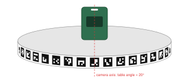
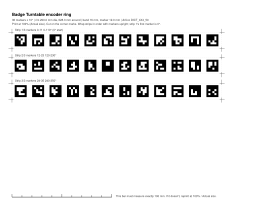
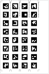

# Encoder ring

The Badge Turntable app reads the turntable's angle from a printed band of markers wrapped around the rim. This page explains how the ring works, how to make one, and how to fit it. The app spec is in [../Spec.md](../Spec.md).



## How it works

### The markers

The band is a row of [ArUco](https://docs.opencv.org/4.x/d5/dae/tutorial_aruco_detection.html) markers, square black-and-white codes that OpenCV can find and identify in a camera image. Each one is a 4×4 grid of bits inside a black border. The ring uses OpenCV's `DICT_4X4_50` dictionary, which has 50 distinct codes chosen to be hard to confuse with each other, even when rotated or partly blurred.

Marker *k* is centred at **k × step** degrees around the rim, where step = 360° / marker count. With 36 markers the step is 10°, so marker 0 is at 0°, marker 1 at 10°, and so on up to marker 35 at 350°. Strip 1 starts half a step before marker 0, so marker 0's centre is exactly 0°.

Because every marker has its own ID, the ring is an **absolute** encoder. Any single camera frame says where the table is, without counting from a home position. That means the app can:
- check that every move actually happened, and spot a turntable that didn't turn,
- stop the table at a target angle (closed-loop control),
- trim the spin video to exactly one revolution so it loops cleanly.

### From markers to an angle

Let θ be the **table angle**: the ring angle currently facing the camera. A marker at ring angle α is (α − θ) around the rim from the camera axis. Seen from the camera, its centre is displaced sideways by the sine of that angle:

```
x = x_axis + R · sin(α − θ)
```

Here `x` is the marker's horizontal pixel position, `x_axis` is the pixel column of the turntable's spin axis, and `R` is the rim radius in pixels. The app doesn't know `x_axis`, `R` or θ in advance. Expanding the sine makes the equation linear in three unknowns:

```
x = x_axis + A · sin α + B · cos α      where A = R cos θ, B = −R sin θ
```

So each frame needs only an ordinary least-squares fit over the visible markers (3 or more):

```
[1  sin α_k  cos α_k] · [x_axis, A, B]ᵀ = x_k      for every detected marker k
R = hypot(A, B)
θ = atan2(−B, A)
```

This needs no initial guess, and it re-measures `x_axis` and `R` every frame. So zooming, refocusing or bumping the phone doesn't upset the angle reading. A residual check rejects frames where a marker was misread.

Typically 13–15 markers are visible on the front half of the ring. Markers near the edges are foreshortened and less precise, so the fit weights them by cos(α − θ).

**Direction.** The formula assumes marker IDs increase from left to right as seen from the camera, which is what you get if the strips are applied upright. If they're upside down, the IDs run the other way. Calibration detects this and flips the sign.

**Perspective.** The formula above assumes a distant camera. In a light box the camera is only 4–8 rim radii away, so markers nearer the camera look further apart, and the plain fit is off by 1–2° rms and up to 4°. With five or more markers, the app refines the fit with the perspective model `x = x_axis + s·sin(α − θ) / (1 − k·cos(α − θ))`, where k is the rim radius divided by the camera distance. It does this with a few Gauss-Newton steps, starting from the linear fit. Like `x_axis`, k is re-measured every frame.

**Accuracy.** Tested on simulated camera images: the generated ring wrapped onto a 146 mm cylinder and rendered from 300–600 mm, with lens and spin motion blur and sensor noise, then detected with OpenCV. With perspective, the angle came out within about 0.1° rms (worst 0.5°, on a low-resolution frame). Print scale and how evenly the band is wrapped will add to that in practice. Either way, it's well within the ±2° positioning tolerance.

### What calibration adds

The ring gives the angle. Calibration (in the app) learns how the *turntable* behaves: rotation speed, which way it turns, and how far it coasts after a stop command. It also learns where **zero** is, which defaults to marker 0 facing the camera. See [Calibration](../Spec.md#calibration) in the spec.

## Making a ring

### 1. Measure the rim

- **Circumference:** wrap a strip of paper around the rim, mark where it overlaps, and measure it flat. This is more accurate than measuring the diameter.
- **Band height:** measure the height of the flat vertical face of the rim that the camera can see. Use slightly less than the full height so the band doesn't overhang.
- **Draft angle:** moulded rims are often slightly tapered. Measure the diameter at the top and bottom of the rim. A straight strip wrapped on a taper wants to curve: unrolled, the band is an arc of radius r × h / Δr (rim radius × rim height / difference in radius). A straight strip of length L laid on it, centred, has its ends about L² × Δr / (8 × r × h) off the line. If that's a sizeable part of the spare rim height, use `--strip-length` for shorter strips; the offset falls with the square of the length.

### 2. Generate it

Use either of these:

- **Browser:** open [index.html](index.html) through the Jekyll dev server (`http://localhost:4000/badges/apps/encoder-ring/`) or the published site. It won't work opened straight from disk, because browsers block module scripts on `file://`. Enter the measurements, choose paper or label, then **Print** or **Download ZPL**.
- **Command line** (Node 18+):

  ```bash
  node make-ring.mjs --circumference 628 --height 16                 # US Letter SVG pages
  node make-ring.mjs --circumference 628 --height 16 --paper a4      # A4
  node make-ring.mjs --circumference 628 --height 16 --zpl --dpi 203 # 4x6 label ZPL + previews
  node make-ring.mjs --help
  ```

The generator picks the most markers that fit, using a count that divides 360 evenly so each marker sits on a whole degree. It sizes each marker at ¾ of the band height (a 6-cell marker inside an 8-cell band, leaving one quiet cell above and below) and leaves at least two cells of white between neighbouring markers. `--count` overrides the marker count. `--strip-length` caps how long each strip is.

| Rim Ø (mm) | Band (mm) | Markers | Marker (mm) | US Letter | 4×6 label |
| --- | --- | --- | --- | --- | --- |
| 150 | 12 | 36 × 10° | 9.0 | 2 strips, 1 page | 4 strips, 1 label |
| 150 | 16 | 24 × 15° | 12.0 | 2 strips, 1 page | 4 strips, 1 label |
| 200 | 12 | 45 × 8° | 9.0 | 3 strips, 1 page | 5 strips, 1 label |
| 200 | 16 | 36 × 10° | 12.0 | 3 strips, 1 page | 5 strips, 2 labels |
| 200 | 20 | 30 × 12° | 15.0 | 3 strips, 1 page | 5 strips, 2 labels |
| 250 | 16 | 45 × 8° | 12.0 | 4 strips, 1 page | 6 strips, 2 labels |
| 300 | 20 | 45 × 8° | 15.0 | 4 strips, 1 page | 8 strips, 3 labels |

What matters for detection is pixels, not millimetres: each marker cell should be about 3 px or more in the app's analysis frame. In simulation a 9.5 mm band (7.1 mm markers) was read reliably from 2.5 px/mm at the rim, which is roughly a 290 mm wide view at 720 px. Frame the badge closely and small markers are fine. On a rim under about 8 mm, use a taller band of card glued around it.

**JAYEGT 5.74 in:** use `node make-ring.mjs --circumference 460.9 --height 9.5`, which gives 45 markers of 7.1 mm at 8°. The rim tapers from 145.25 to 145.9 mm across its 9.6 mm height (about 1.9°), so the default 123 mm strips end up about 0.9 mm off line. If they won't sit within the rim, add `--strip-length 65` for eight strips of about 61 mm (about 0.2 mm off line, two labels). The rim measures about 145.6 mm across at mid-band (457.3 mm around) and 9.6 mm tall. The ZD500 used to print it feeds about 0.8% short (five marker spacings measured 50.38 mm against 50.72 mm designed), so a band generated for 456.5 mm left a 4.46 mm gap. 460.9 mm is that band plus the gap, and it prints at about 457.2 mm. Fitted as a black band, it left the seam about 0.75 mm tight (2.35 mm between the last and first markers, against about 3.1 mm elsewhere), so `--circumference 460.2` would close it exactly. That is well within tolerance, and it isn't worth reprinting for.

### Black band (`--invert`)

On a black rim, a white band shows up in every badge photo. `--invert` prints a black band with white-bordered markers instead: the standard ArUco markers with every cell's colour swapped. The app reads both kinds without any setting, because its detector has OpenCV's `detectInvertedMarker` turned on.

- **Cutting:** the black runs 1 mm past every cut line (bleed), so a slightly off cut still leaves a black edge. The corner marks cross as usual. Where they cross the black they print white, and where they run out onto the bare label they print black. Cut along the line through the marks. After any cut, the white marks on the black still show the other cut lines.
- **Readability:** in simulation, an inverted band read as well as a white one from about 3 px/mm at the rim. Below that it found fewer markers, and at 2.5 px/mm its worst readings were about 2.5° off, against 0.3° for a white band. So frame closer with a black band: no more than about 240 mm of rim across a 720 px wide view.
- **Printing:** large black areas take more heat on a thermal printer, so raise the darkness if the black comes out grey. Direct-thermal black also browns over months in light, which slowly lowers contrast.

### 3. Print it

**Paper (US Letter or A4).** Print at **100% / Actual size**, never "Fit to page". Each page has a 100 mm scale bar; measure it before cutting. Matte paper or full-sheet matte sticker paper works best, because glossy paper reflects the light box's LEDs and washes out markers.



**4×6 in shipping label (ZPL).** The ZPL draws each marker cell as a filled box (`^GB`), so it prints at the printer's native resolution with no image scaling. Choose the dpi that matches your printer: 203 dpi is standard on most Zebra-compatible label printers, and 300 dpi on higher-end models. Strips run along the 6 in length, with several side by side.



To send the ZPL to the printer, use one of these:
- **Zebra Setup Utilities:** use "Open Communication With Printer", then "Send File".
- **Network printer:** `nc <printer-ip> 9100 < ring-4x6-203dpi.zpl`
- **Windows shared printer:** `copy /b ring-4x6-203dpi.zpl \\localhost\<ShareName>`
- **CUPS raw queue:** `lp -d <queue> -o raw ring-4x6-203dpi.zpl`
- **PowerShell, network printer:** `$c = [Net.Sockets.TcpClient]::new('<printer-ip>', 9100); $b = [IO.File]::ReadAllBytes('ring-4x6-203dpi.zpl'); $c.GetStream().Write($b, 0, $b.Length); $c.Close()`

**After loading new label stock**, have the printer measure it first: send `~JC` the same way, or use the printer's calibrate function. It feeds a label or two. Until then the printer keeps the old label length, and a 6 in ring label can be split across labels or skip one. Sending `~HS` returns the printer's status. Its first line's fourth field is the label length in dots: about 1218–1240 for 4×6 in at 203 dpi.

Label printers can feed up to about 1% short or long along the label: a ZD500 here printed 0.8% short. Across the label the size comes from the print head's fixed dot spacing, so the band height is exact. The seam-gap fix in [Fit it](#4-fit-it) corrects for feed scale automatically.

The label version has no scale bar. Check the scale by measuring a strip: each strip is its marker count (in its caption) × the pitch, which is the circumference divided by the total marker count. On the JAYEGT ring that's 456.5 / 45 = 10.14 mm, so a 12-marker strip is 121.7 mm.

Direct-thermal labels fade over months in bright light. If the ring starts reading poorly, reprint it, or use thermal-transfer labels if your printer supports them.

A sample label file is in [docs/example-label-4x6-203dpi.zpl](docs/example-label-4x6-203dpi.zpl) (200 mm rim, 16 mm band).

### 4. Fit it

1. Clean the rim so the band sticks flat.
2. Cut each strip on its corner marks. At each corner the marks for the two cuts cross, and each runs a short way past the corner along the strip's edge. So after any cut, a stub of every other mark is still on the piece you keep, and the cuts can go in any order. Cut along the line through the marks. If a sliver of a stub stays on the strip, it's harmless: it's on the band's edge next to the black rim, or well clear of the markers.
3. Apply **strip 1** first, with its captioned edge up and the markers upright, so marker 0 is roughly where you want the badge's front to face. (The exact zero is set in calibration.)
4. Apply the remaining strips in order, butting each strip's end against the previous one with no gap and no overlap. Each strip ends half a gap past its last marker, so butted strips keep the spacing even.
5. The last strip should meet the start of strip 1. A gap or overlap of a millimetre or two is fine. If it's more, reprint with `--circumference` set to the old band length plus the gap (or minus the overlap). This also corrects for printer scale, label thickness and measuring error, because it's based on what actually printed.
6. In the app, open the ring check. Turn the table by hand: the angle should increase smoothly with no jumps, and every marker ID should be found.

## Files

| File | What it is |
| --- | --- |
| [ring.js](ring.js) | Generator library: marker codes, layout, SVG and ZPL output. Shared by the page and the CLI. |
| [index.html](index.html) | Browser generator. |
| [make-ring.mjs](make-ring.mjs) | Command-line generator. `--docs` regenerates the images in [docs/](docs/). |
| [docs/](docs/) | Images used on this page and a sample ZPL file. |

The marker codes in `ring.js` are the first 250 entries of OpenCV's `DICT_4X4_1000` table. `DICT_4X4_50`, `_100` and `_250` are prefixes of it, so the app can use `cv::aruco::DICT_4X4_50` directly.
